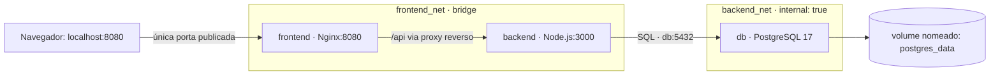

# Em dia — Kanban com Docker

Trabalho avaliativo de DevOps: aplicação de três camadas com frontend web, API autenticada por JWT e PostgreSQL com volume nomeado. O quadro permite criar, editar, excluir e mover tarefas entre **A fazer (to-do)**, **Em andamento (doing)** e **Concluído (done)**.

## Executar com um comando

Pré-requisito: Docker Desktop iniciado, usando contêineres Linux, com Docker Compose. No Linux, Docker Engine e o plugin Compose também servem. A primeira execução precisa de internet para baixar as imagens e dependências. Não é necessário instalar Node.js ou PostgreSQL no computador para usar a aplicação.

Extraia o ZIP, abra o terminal na pasta que contém `docker-compose.yml` e execute:

```sh
docker compose up --build
```

A forma solicitada no enunciado, `docker-compose up --build`, também funciona quando o executável de compatibilidade `docker-compose` estiver instalado. Os exemplos usam a sintaxe atual `docker compose`.

Espere os três serviços iniciarem e abra **http://localhost:8080**.

| Campo | Valor |
| --- | --- |
| Usuário | `admin` |
| Senha | `admin` |

O esquema e o usuário são criados automaticamente na primeira inicialização. Não é necessário rodar SQL manualmente, copiar `.env` nem criar volumes. O quadro começa vazio.

Para usar uma conta própria, clique em **Criar conta** na tela de login, informe usuário, senha e confirmação e envie o cadastro. A aplicação entra automaticamente no quadro da nova conta. Cada usuário vê somente suas próprias tarefas; a conta `admin/admin` permanece disponível para a avaliação.

Para executar em segundo plano e esperar os serviços estarem saudáveis:

```sh
docker compose up --build -d --wait
docker compose ps
```

### Aparência

A interface oferece **tema claro e escuro** no botão do topo, tanto no login/cadastro quanto no quadro. No primeiro acesso, segue a aparência do sistema. Ao alternar, salva sua preferência no navegador e a mantém após recarregar, sair ou entrar em outra conta. A escolha é local ao navegador e sincronizada entre abas; se o armazenamento estiver bloqueado, a troca continua funcionando durante a página atual. O tema é aplicado antes do CSS para evitar a troca de cores durante o carregamento.

O layout se adapta a computadores e celulares, com resumo de progresso, cartões por etapa e formulários com mensagens de retorno. Em telas estreitas, as colunas do Kanban ficam empilhadas; o seletor em cada cartão permite mover tarefas sem arrastar.

## Arquitetura e isolamento



| Serviço | Imagem / função | Redes | Porta no computador |
| --- | --- | --- | --- |
| `frontend` | Nginx Alpine; HTML, CSS, JavaScript e proxy | `frontend_net` | `127.0.0.1:8080` |
| `backend` | Node.js 24 Alpine; Express e JWT | `frontend_net`, `backend_net` | Nenhuma |
| `db` | PostgreSQL 17 Alpine | `backend_net` | Nenhuma |

- O frontend não pertence à rede do banco. Só a API participa das duas redes.
- `backend_net` é interna. Não há publicação das portas 3000 ou 5432 no host.
- O navegador chama `/api` na mesma origem da página. O Nginx resolve `backend` pelo DNS do Docker; isso evita erros de CORS sem liberar origens indiscriminadamente.
- `depends_on` com `service_healthy` respeita a sequência banco → API → frontend. Há healthchecks nos três serviços.
- `EXPOSE`/`expose` documentam portas; quem publica acesso no host é `ports`.
- Frontend e backend rodam sem root, com filesystem de leitura e escrita temporária em `/tmp`; não há bind mounts nem caminhos absolutos no Compose.
- As dependências da API são fixadas no `package-lock.json` e instaladas com `npm ci`. Os contextos de build usam `.dockerignore`.

## Autenticação e dados

O login retorna um JWT válido por duas horas. A interface envia `Authorization: Bearer <token>` em todas as operações de tarefas. A API verifica assinatura, algoritmo, expiração, emissor e audiência antes de permitir a operação. As consultas são limitadas ao usuário do token e usam parâmetros SQL.

O cadastro também retorna um JWT. Nomes de usuário aceitam de 3 a 32 caracteres: letras sem acento, números, ponto, hífen e sublinhado. São convertidos para minúsculas e têm espaços externos removidos; nomes já usados retornam **409**, inclusive em cadastros simultâneos. Novas senhas precisam ter de 8 a 200 caracteres e não podem conter apenas espaços. A confirmação é validada na interface; a API valida os dados independentemente dela. A senha didática `admin` continua válida para a conta inicial.

Ao recarregar a página, a interface consulta `/api/auth/me` para restaurar o nome e o avatar da conta autenticada. O backend confirma que o usuário do token ainda existe. Não há privilégios administrativos sobre tarefas alheias: `admin` também vê somente seu próprio quadro. Há limites de tentativas por IP para login e cadastro.

A senha do usuário é persistida como hash com salt, usando `scrypt`. O token fica em `sessionStorage`; sair remove a sessão no navegador, e respostas 401 pedem um novo login. O logout é local: um token já emitido continua válido até expirar. Títulos e descrições são tratados como texto na interface.

O login, o cadastro e `/api/health` são públicos. `/api/auth/me` e todas as rotas de tarefas exigem JWT:

| Método | Caminho | Resultado |
| --- | --- | --- |
| POST | `/api/auth/login` | `{token, user, expiresIn}` |
| POST | `/api/auth/register` | `201`, `{token, user, expiresIn}`; recebe `{username, password}` |
| GET | `/api/auth/me` | `{user: {username}}`, com JWT |
| GET | `/api/health` | Estado da API e da conexão com o banco |
| GET | `/api/tasks` | `{tasks: [...]}` |
| POST | `/api/tasks` | `201`, `{task: {...}}` |
| PATCH | `/api/tasks/:id` | `{task: {...}}` |
| DELETE | `/api/tasks/:id` | `204`, sem corpo |

Exemplo de tarefa enviada: `{"title":"Preparar apresentação","description":"Demonstrar o volume","status":"todo"}`. Status aceitos: `todo`, `doing`, `done`. Título: até 120 caracteres; descrição: até 2000. A API responde com mensagens em português, incluindo erro 400 para entradas inválidas, 401 para autenticação inválida e 404 para tarefas inexistentes.

## Roteiro de testes

### 1. Interface, login e comunicação

1. Tente entrar com senha incorreta: deve aparecer uma mensagem de erro.
2. Entre com `admin/admin` e crie uma tarefa com título e descrição.
3. Edite os dados. Mova a tarefa entre as três colunas, arrastando o cartão ou usando seu seletor de status.
4. Recarregue a página: os dados devem continuar iguais.
5. Exclua uma tarefa de teste e confirme que ela desaparece.
6. Saia: o quadro deve ficar inacessível até um novo login.
7. Nas ferramentas de desenvolvedor do navegador, aba Rede, veja as chamadas `/api/tasks` com cabeçalho Bearer e respostas da API.
8. Saia, clique em **Criar conta** e tente confirmar uma senha diferente: a interface deve impedir o envio.
9. Cadastre um usuário novo com senha de ao menos oito caracteres. Confira a entrada automática, seu nome no cabeçalho e o quadro vazio.
10. Crie uma tarefa, recarregue e depois saia e entre novamente com a nova conta: nome e tarefa devem continuar corretos.
11. Entre com `admin/admin`: a tarefa da outra conta não deve aparecer. Um cadastro com nome já existente deve mostrar um erro.
12. Alterne os temas no login e no quadro. Confira campos, cartões, mensagens e modais em ambos; recarregue e confirme que a escolha continua salva.
13. Em uma tela estreita, confira o quadro em uma coluna e use o seletor de etapa dos cartões para movimentar tarefas.

### 2. Persistência após destruir e recriar contêineres

Crie uma tarefa chamada **Comprovação de persistência**, coloque uma descrição e mova-a para **Em andamento**. Depois execute:

```sh
docker compose ps -q
docker volume inspect avaldevops_postgres_data
docker compose down
docker compose up --build -d --wait
docker compose ps -q
docker volume inspect avaldevops_postgres_data
```

Entre novamente e confira a mesma tarefa, descrição e status. Os IDs dos contêineres mudam, mas o volume `avaldevops_postgres_data` é reutilizado. O volume fica montado em `/var/lib/postgresql/data`, fora do filesystem descartável do contêiner.

**Não use `docker compose down -v` nesse teste:** a opção `-v` apaga os volumes e, portanto, os dados. Um volume oferece persistência entre recriações; ele não substitui um backup.

### 3. Testes automatizados

Com a aplicação em execução, instale Node.js 22 ou superior no host apenas se quiser rodar os scripts opcionais. Eles não precisam de `npm install`:

```sh
node scripts/test-api.mjs
node scripts/test-registration.mjs
node scripts/test-persistence.mjs
node --test scripts/test-theme.mjs
```

O teste de API exercita autenticação e CRUD através do Nginx e do PostgreSQL reais. O teste de cadastro cria duas contas, verifica duplicidade simultânea, validações, login, identidade e isolamento de tarefas. Ele usa o PostgreSQL da stack local para conferir hashes e limpar somente as contas criadas naquela execução; não deve ser usado contra um servidor remoto.

Os testes de tema não precisam de Docker: executam o script de aparência com as APIs do navegador simuladas e verificam preferência do sistema, escolha salva, alternância, armazenamento bloqueado e sincronização entre abas. A conferência visual usa o roteiro manual acima.

O teste de persistência cria uma tarefa identificável, executa `down` sem `-v`, recria os três serviços, compara os IDs dos contêineres e o volume e verifica os mesmos dados pela API. Ele interrompe temporariamente a aplicação; rode fora de uma demonstração em andamento. Os testes limpam apenas os dados que criaram.

Para verificar também a persistência de contas, senhas e tarefas após recriar os contêineres, execute `node scripts/test-registration.mjs --recreate`. Essa opção também interrompe temporariamente a stack, sem apagar volumes. O relatório fica em `.artifacts/registration-result.json`.

Para manter a tarefa de comprovação no quadro:

```sh
node scripts/test-persistence.mjs --keep-task
```

O teste de persistência também grava seu resultado em `.artifacts/persistence-result.json`. Os testes da API que não exigem banco podem ser executados com:

```sh
cd backend
npm ci
npm test
```

As evidências da validação feita nesta entrega estão em [docs/evidencias.md](docs/evidencias.md). O [roteiro de apresentação](docs/roteiro-apresentacao.md) ajuda a explicar as decisões de infraestrutura.

## Configuração e diagnóstico

O `.env.example` documenta variáveis opcionais. Para alterá-las, copie-o para `.env` antes de iniciar. Se a porta 8080 estiver ocupada, ajuste `HTTP_PORT`, por exemplo `HTTP_PORT=8081`, e abra a nova porta. Para os scripts de teste, configure `BASE_URL` ou `HTTP_PORT` no ambiente do terminal; os scripts não leem o `.env` do Compose automaticamente.

As credenciais e o segredo JWT padrão são **didáticos e destinados à avaliação local**. A porta publicada aceita conexões apenas do próprio computador. Para outro ambiente, troque os segredos e configure HTTPS. As variáveis `POSTGRES_*` inicializam um volume novo; alterá-las não muda automaticamente usuários e senhas de um banco já existente.

```sh
docker compose config --quiet
docker compose ps
docker compose logs --tail 100 backend db frontend
docker network inspect avaldevops_backend_net
docker volume inspect avaldevops_postgres_data
```

Para parar mantendo os dados: `docker compose down`. Para iniciar outra vez: `docker compose up --build`.

## Organização e entrega

```text
.
├── docker-compose.yml
├── .env.example
├── .gitignore
├── .gitattributes
├── README.md
├── nomes.txt
├── backend/                 # API, Dockerfile, lockfile e testes
├── frontend/                # Interface, Dockerfile e Nginx
├── scripts/                 # Testes reais e empacotamento
└── docs/                    # Evidências e roteiro de apresentação
```

No PowerShell, para gerar os dois arquivos solicitados pelo professor:

```powershell
powershell -NoProfile -ExecutionPolicy Bypass -File scripts/package-delivery.ps1
```

Saída: `entrega/trabalho-devops.zip` e `entrega/nomes.txt`. O ZIP contém o código, a documentação e também uma cópia de `nomes.txt`. Exclui `.env`, `node_modules`, logs e temporários. Não inclui os dados do volume: cada avaliador começa com seu próprio banco.

| Critério | Onde conferir |
| --- | --- |
| Compose (2,5) | Três serviços, redes, healthchecks e apenas uma porta publicada |
| Persistência (2,5) | Volume nomeado, roteiro e teste de recriação |
| Dockerfiles (2,0) | Alpine, WORKDIR, COPY, EXPOSE e contextos enxutos |
| Comunicação (1,5) | Proxy na mesma origem, JWT e mensagens de sucesso/erro |
| Documentação (1,5) | README, testes, `.gitignore`, organização e nomes |

## Referências técnicas

- [Docker: ordem de inicialização com healthchecks](https://docs.docker.com/compose/how-tos/startup-order/)
- [Docker: volumes persistentes](https://docs.docker.com/engine/storage/volumes/)
- [Docker: declaração de redes no Compose](https://docs.docker.com/reference/compose-file/networks/)
- [Node.js: versões e ciclo de suporte](https://nodejs.org/en/about/previous-releases)
- [Imagem oficial PostgreSQL](https://hub.docker.com/_/postgres)
